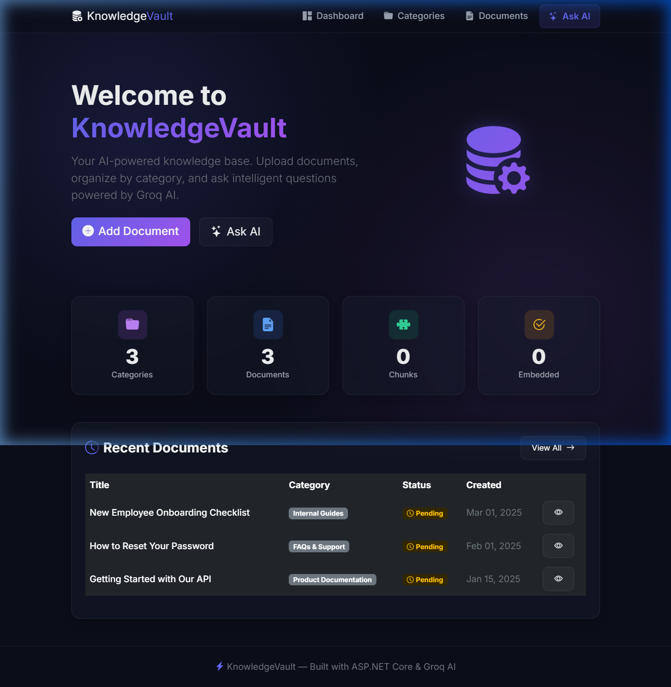

# KnowledgeVault AI 🧠💼

KnowledgeVault AI is a premium, multi-tier **ASP.NET Core MVC** web application that acts as a local **Retrieval-Augmented Generation (RAG)** knowledge base. It allows users to store standard documentation, auto-segment files into semantic chunks, generate embeddings locally using **Ollama**, and query documents with ultra-fast responses powered by **Groq AI (Llama 3)**.

The project uses **Qdrant** as a high-performance vector database to perform semantic searches, paired with **SQL Server** for structured relational storage.

---

## 📸 Interface Preview



---

## 🚀 Key Features

*   **Semantic Search & RAG**: Query your knowledge base using natural language and get answers contextually grounded in your documents.
*   **Multi-Tier Clean Architecture**: Clear division of concerns across Controllers, business Services, EF Repositories, and DB layers.
*   **Local Embedding Generation**: Uses Ollama with the lightweight `all-minilm` model (384-dimensional vectors) to encrypt and vectorise text locally.
*   **Fast Vector Database**: Managed Qdrant vector database via high-performance gRPC channels.
*   **Ultra-Fast LLM Reasoning**: Seamless integration with the Groq API utilizing `llama-3.3-70b-versatile` for immediate completion summaries.
*   **Modern Premium UI**: Sleek, glassmorphism dark-theme layout with micro-animations and a responsive chat dashboard.

---

## 🛠 Tech Stack

*   **Backend Framework**: .NET 10.0 (ASP.NET Core MVC)
*   **Database (Relational)**: SQL Server (via EF Core Code-First Migrations)
*   **Vector Database**: Qdrant (gRPC Client integration)
*   **Local Embeddings**: Ollama (`all-minilm`)
*   **LLM Inference**: Groq AI API (`Llama 3`)
*   **Frontend**: HTML5, CSS3 (Vanilla glassmorphism styling), Vanilla JavaScript

---

## 🚦 Getting Started

### Prerequisites
*   [.NET 8.0 SDK / .NET 10.0 SDK](https://dotnet.microsoft.com/download)
*   [Docker Desktop](https://www.docker.com/products/docker-desktop/) (to run Qdrant and Ollama)
*   SQL Server LocalDB (usually installed with Visual Studio) or a SQL Server instance

---

### Step-by-Step Setup

#### 1. Spin up Databases with Docker
Run this command in the project root to launch Qdrant and Ollama containers in the background:
```bash
docker-compose up -d
```

#### 2. Configure Ollama Embedding Model
Initialize the local embedding model inside the active Ollama container:
```bash
docker exec ollama_service ollama pull all-minilm
```

#### 3. Database Migration & Seeding
Apply Entity Framework migrations to configure the SQL Server database schema and seed the initial categories/documents:
```bash
dotnet ef database update --project src/MultiTierApp.Web
```

#### 4. Configure Groq API Key
Open `src/MultiTierApp.Web/appsettings.json` and replace the API Key placeholder with your Groq API Key:
```json
"GroqApi": {
  "ApiKey": "YOUR_GROQ_API_KEY",
  "BaseUrl": "https://api.groq.com",
  "Model": "llama-3.3-70b-versatile"
}
```

#### 5. Run the Application
Launch the .NET web application server:
```bash
dotnet run --project src/MultiTierApp.Web
```
Access the application dashboard by navigating to:
👉 **[http://localhost:5179](http://localhost:5179)**

---

## 📁 Project Structure

```
├── assets/                     # Screenshots and markdown media
├── src/
│   └── MultiTierApp.Web/
│       ├── Controllers/        # Handling HTTP routing & views
│       ├── Services/           # Embedding, LLM (Groq), RAG, and Vector services
│       ├── Repositories/       # Database access layer (Generic & Custom repos)
│       ├── Data/               # Entity Framework DbContext and configurations
│       ├── Models/             # Relational schema objects (Category, Document, etc.)
│       └── Views/              # Dashboard pages and RAG chat views
├── docker-compose.yml          # Container configuration for Qdrant and Ollama
└── MultiTierApp.slnx           # Solution XML definition
```
